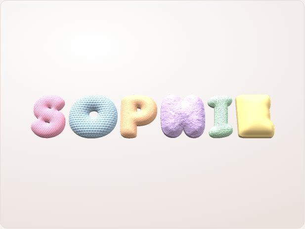
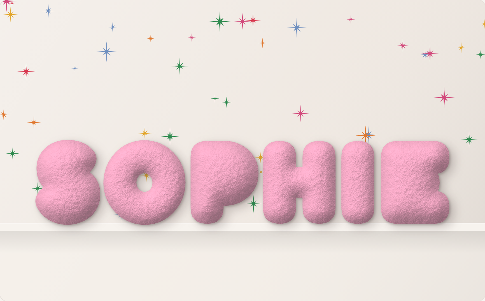
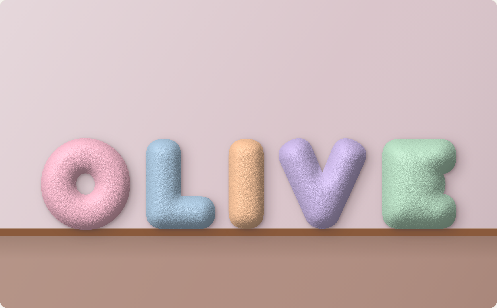

# Textured bubble letters

This repo has two tools:

- **`print3d.html`: Bubble Letter Maker for 3D printing.** It makes printable
  3MF and STL files for Bambu Studio (Bambu Lab P1S + AMS).
- **`index.html`: a 2D picture generator.** It renders puffy letters as a PNG image.

## Bubble Letter Maker (3D printing)

Open `print3d.html` in a browser. It needs an internet connection for the
fonts and the 3D preview.

1. Type a word and press **Make letters**. Each letter gets its own card.
2. For each letter, choose:
   - **Font:** Fredoka, DynaPuff, Baloo 2, Sniglet, Chewy, Titan One,
     Lilita One or Bubblegum Sans. "Mix" gives each new letter a different font.
   - **Height** in mm.
   - **Colour.**
   - **Texture:** smooth, wool (yarn wrapped), crochet stitches, ceramic
     (sandy), fluffy (soft lumps) or fuzzy (fine fuzz).
3. Adjust the shared settings: texture depth, puffiness, chubbiness, flat base
   thickness and mesh detail. You can also ask for a mirrored back half per
   letter. Glue it on for a fully round letter that stands up.
4. **Download print files (.zip)** gives you:
   - `<word>.3mf`: every letter as a separate object, named with its AMS slot,
     e.g. `O - slot 1 Pink`.
   - `stl/<letter>.stl`: one file per letter.
   - `print-guide.txt`: which filament goes in which AMS slot, plus the slicer steps.
   - `<word>-template.json`: reload it later with **Load template**.

Each letter is a watertight solid with a flat back, so it prints flat side down
with no supports. The texture is real geometry in the domed front surface.

### In Bambu Studio

1. Choose File > Import and pick the `.3mf`. If asked, load geometry only.
2. Select each letter and set its filament to the slot named in the object name.
3. Press **A** to arrange the plate. If the letters don't fit on one plate, add a plate first.
4. Suggested settings: 0.16 mm layers, 2 to 3 walls, 10 to 15% gyroid infill.
   For fuzzy or fluffy letters, also turn on Fuzzy Skin (outer walls).

The fonts are from Google Fonts and use the SIL Open Font License, which allows
selling printed products made with them.

## 2D picture generator

Puffy 3D-looking letters with a fleece or sandy-ceramic texture, drawn in the
browser with plain Canvas 2D. It needs no libraries and no build step.

Open `index.html` in a browser. You can change the text, the colours, how puffy
and chubby the letters are, how strong the texture is, and the background. Use
**Download PNG** to save the image.

| Fleece | Ceramic |
| --- | --- |
|  |  |

### How the 2D generator works (`bubble-letters.js`)

Each letter is rendered separately:

1. **Mask**: the letter is drawn in a rounded font (Fredoka, Baloo 2 or
   Sniglet) with a thick round-joined stroke. The stroke makes it chubbier and
   rounds every corner.
2. **Distance transform**: an exact Euclidean distance transform gives each
   pixel's distance from the letter's edge.
3. **Inflate**: distance becomes height with a circular profile,
   `h = R·√(1-(1-d/R)²)`, so every stroke becomes a round tube, like a pillow.
   A small blur smooths the crease along the middle of each stroke.
4. **Texture**: procedural value noise is added to the height.
   *Fleece* combines fine fibres with soft clumps. *Ceramic* combines fine
   sandy grain with occasional dark speckles.
5. **Shade**: normals are computed from the height and lit by a light at the
   upper left. Fleece uses wrapped diffuse light with a velvet rim sheen.
   Ceramic uses a faint matte specular highlight. Lower areas get some ambient
   occlusion.
6. **Composite**: the letter is placed on the scene with a soft drop shadow and
   a tighter contact shadow.
