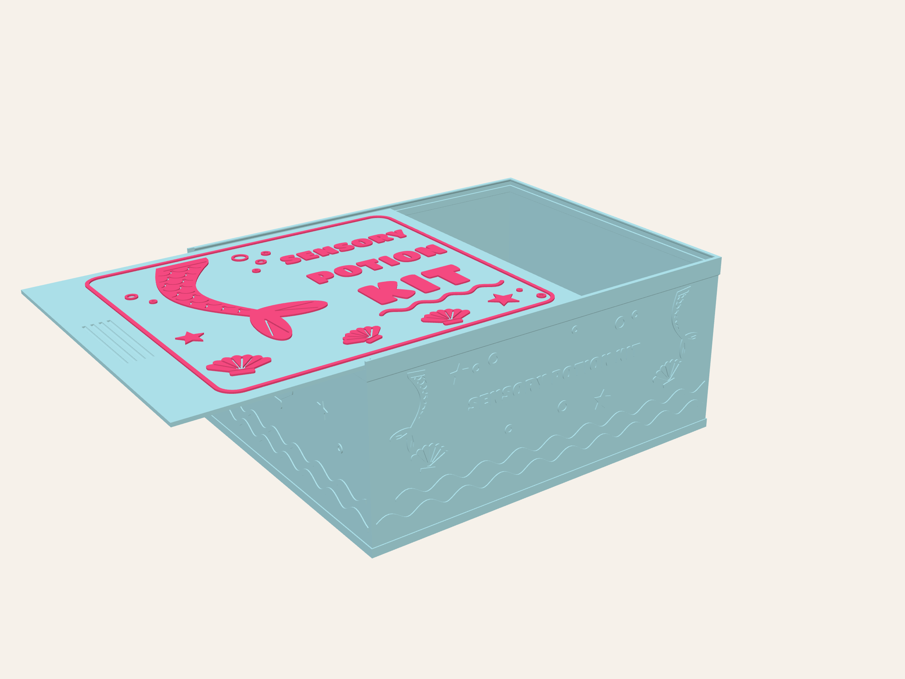

# Sliding-lid packaging box

Outside size: **220 mm wide × 177 mm deep × 100 mm high**, open at the top. The inside opening is
215.2 × 172.2 mm with 94.6 mm under the lid, so a 210 × 170 × 75 mm toy fits with about 1 mm to spare on each side.

- `out/box.stl`: the box body
- `out/lid.stl`: the sliding lid
- `make_box.py`: regenerates both (`pip install manifold3d numpy`, then `python3 make_box.py`).
  All sizes are at the top of the file.

**How it works:** the lid slides in through the lowered front wall, running in grooves
in the side walls. It stops against the back wall, which also has a groove. A small bump on top
of the front wall clicks into a notch under the lid, so the lid stays shut. To open it,
push the thumb ridges near the front edge.

**Fast print settings (Bambu Studio, P1S, 0.4 nozzle, PLA).** Print each part on its own plate,
flat side down. Neither part needs supports: the groove roofs are 45° chamfers, and the lid notch only removes material.

| Setting | Value | Why |
|---|---|---|
| Process preset | 0.28mm Extra Draft | fewest layers (about 360 instead of about 500 at 0.20) |
| Filament preset | Bambu PLA Basic, or Max volumetric speed 18-21 mm³/s | generic PLA is capped at 12 mm³/s, which is often the real limit |
| Wall loops | 3 | fills the 2.4 mm walls solid with long lines and no slow gap fill |
| Inner wall / sparse infill line width | 0.50 mm | fewer, fatter lines |
| Sparse infill density | 0% (box); 15% (lid) | the box walls are all perimeter anyway |
| Top shell layers | 0 (box); 3 (lid) | the box has no top surface to cover |
| Bottom shell layers | 4 (box); 3 (lid) | 1.2 mm floor |
| Ironing, prime tower | off | |
| Detect overhang walls / slow down for overhangs | off for the box | the only overhangs are the small 45° groove chamfers |

Print the box and the lid at the same time on two printers if you can. They don't fit on one bed together.

## Sensory Potion Kit version (`potion_box.py`), mermaid theme

This is the same box, fit and click-stop, made into themed packaging for the potion kit. Run
`python3 potion_box.py` (it also needs `pip install fonttools`). The files go to `out/potion/`:

- `box.stl`: print in one colour (Light Blue). It has **thin 1.6 mm walls**, made stable by:
  - a solid 2.4 mm band at the top that holds the lid grooves and stiffens the rim
  - a 5 mm foot band at the bottom
  - full-width raised waves that work as stiffening ribs

  The mermaid tails, shells, stars, bubbles and "SENSORY POTION KIT" stand 0.6 mm out from the
  thin wall, and the outside stays exactly 220 × 177 × 100 mm. It uses about 20% less plastic than the solid-wall box.
- `potion-lid.3mf`: the lid is a Light Blue plate with raised Pink art: a mermaid tail, scallop shells, starfish,
  bubbles, the title and a border (slot 1 Light Blue, slot 2 Pink). The art is only the top 3 layers, so the AMS
  swaps only a few times, right at the end.
- `lid-base.stl` + `lid-art.stl`: the same lid as separate parts. With a single-colour printer, add a
  colour-change pause at z = 2.0 mm.
- `preview.html`: a 3D preview (serve this folder with `python3 -m http.server`; `?open=90` slides the lid out,
  `?view=top|side|back` changes the view).

Slicer: 0.28 mm layers, **2 wall loops**, 0% sparse infill for the box, no supports.
The title text is set by `TITLE` / `SIDE_TEXT` at the top of the script. The font is Titan One (SIL Open Font License).
